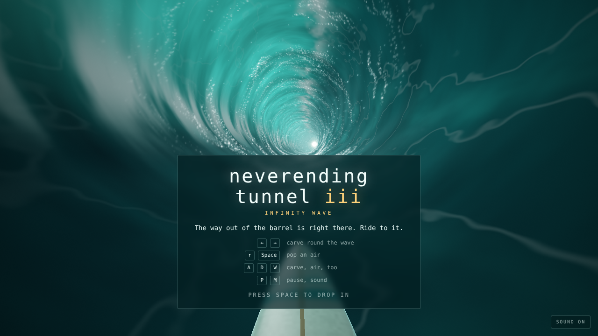
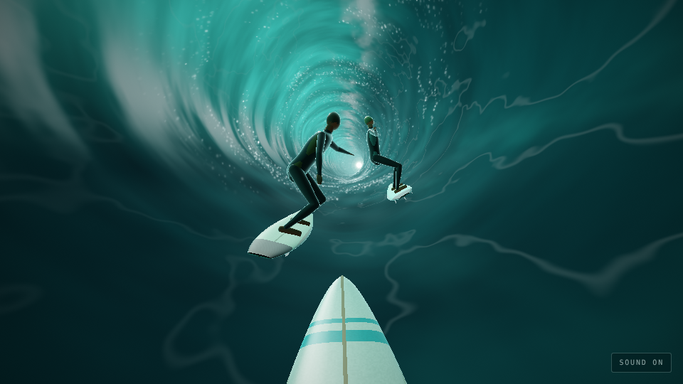
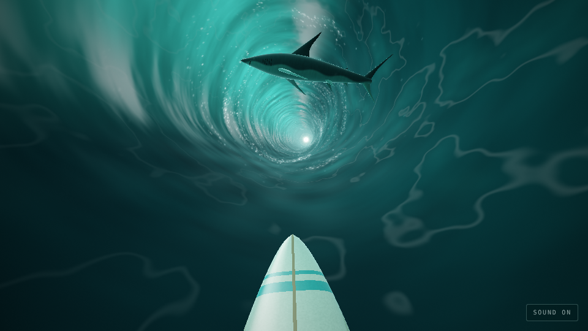
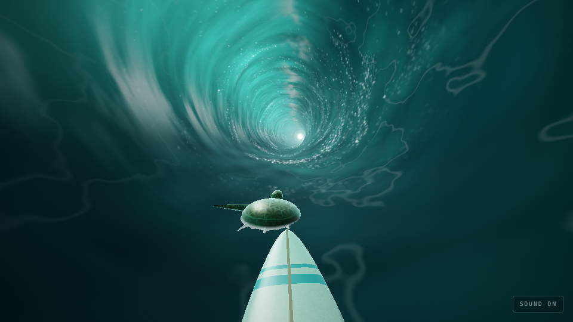
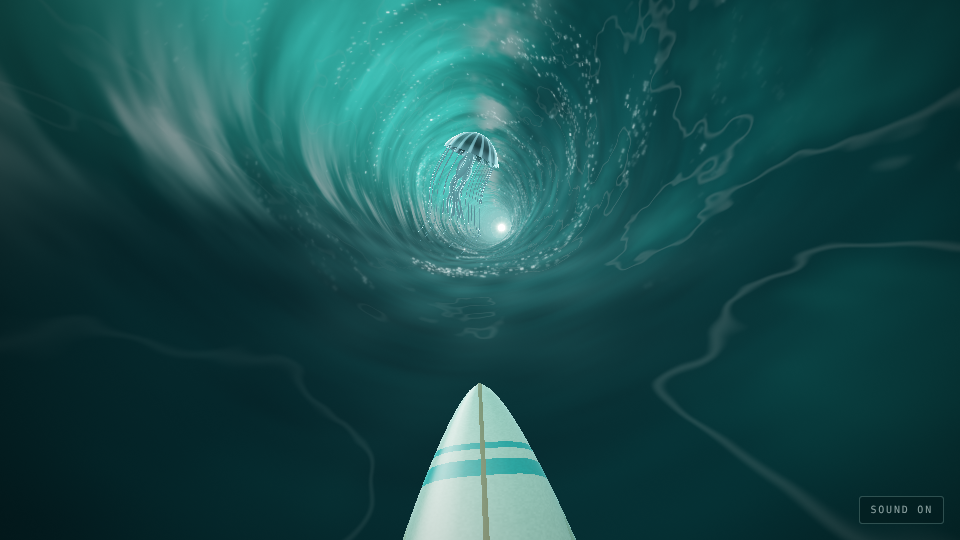

# Neverending Tunnel III: Infinity Wave

Ride an endless barrel, round the other surfers and the sharks, towards the
light. The way out is at the end of the barrel. You never reach it.

The tunnel is water now: a tube of green sea curling over you, thick in the
face, thin and glowing where the lip throws over and the curtain falls, with
foam dragged round it by the flow and daylight at the far end. You see it
over the nose of your board. Like Neverending Tunnel II it's drawn with
WebGPU where the browser has it and WebGL 2 where it doesn't, with the same
shaders written for each (WGSL in `src/shaders`, GLSL in `src/shaders/gl`).



| | |
|---|---|
|  |  |
| Surfers | A shark leaping across |
|  |  |
| A turtle | A jellyfish |

## Run

```sh
npm install
npm run dev      # http://localhost:5173
npm run build    # static build in dist/
```

Needs WebGPU or WebGL 2 (any current browser). `?renderer=webgl` or
`?renderer=webgpu` pins one, and `?particles=40000` sets how much foam and
spray there is (it otherwise starts at 90,000, or 40,000 on phones, and
thins itself out if frames run slow).

## Controls

- ← → / A D: carve round the wave, from the curtain's foot, round the bottom and up the face until it hangs over you
- ↑ / W / Space: pop an air
- Drag: carve, on a phone; tap or flick up: air
- Space / tap: drop in, paddle back out
- P: pause, M: sound

## In the wave

- Surfers, crouched on their boards in a few stances, in wetsuits, springsuits or boardshorts, carving up and down the face
- Packs of surfers right across the face, with one gap
- Shark fins circling: go round, or air over them
- Sharks leaping clean across the barrel
- Turtles at the surface, heads up, rowing
- Loose longboards cartwheeling through the tube
- Jellyfish, pulsing and trailing their tentacles, swept round with the water

Passing close is a near miss: you'll hear it go by.

## Sound

All made as it plays, with Web Audio, no samples: a surf punk band at 176
beats a minute, in E phrygian dominant. The lead is a surf guitar played
low and twangy, the way Dick Dale did: it picks out the riff in the
verses, tremolo-picks the chorus down an A G F E slide, and slides in from
the top of the neck, all through spring reverb. Two rhythm guitars, one
each side, chug palm-muted in the verses and down-pick open power chords
in the choruses, through a tight amp and a dark cabinet. The bass drives
eighths with a sub under it, and the drums play a punk beat, ride the
choruses, fill, and break down to toms, in a small room. The guitars are
plucked strings (Karplus-Strong). When you wipe out, the band crashes on
one last chord and the lead dives off the end of the whammy bar. Under it
all: the roar of the barrel, the hiss of the board over the water, and now
and then a drop pinging off the board.

## Layout

- `src/shaders/tube.wgsl`: the barrel, its whole mesh made up from the vertex index
- `src/shaders/particles.wgsl`: foam and spray, every particle made up from its index
- `src/shaders/things.wgsl`: surfers, boards, sharks, turtles and jellyfish: what each part of them is made of, and the light on them
- `src/shaders/sky.wgsl`: the light at the end
- `src/shaders/post.wgsl`: tone mapping, vignette, flash and fade
- `src/shaders/gl/`: the same five for WebGL 2
- `src/gpu.js`, `src/gl.js`: the WebGPU and WebGL 2 renderers; `src/renderer.js` picks one
- `src/frame.js`: packs each frame's uniforms once for either renderer
- `src/game.js`: riding, carving, airs, the things in the wave, collisions and near misses
- `src/meshes.js`: the surfers, surfboard, shark, turtle and jellyfish, swept along splines and built from foils
- `src/main.js`: the frame loop
- `src/input.js`, `src/hud.js`, `src/sound.js`: controls, HUD, the band and the sea
- `src/constants.js`, `src/math.js`: shared numbers and helpers
